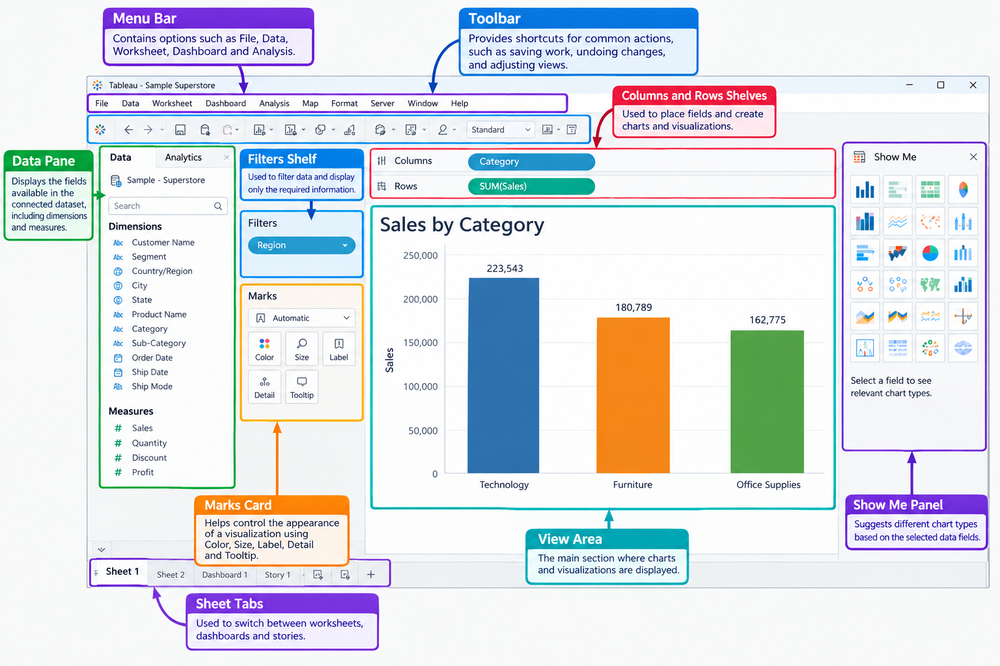

## Introduction to Tableau

Tableau is a data visualization tool used to convert raw data into meaningful charts, graphs, and dashboards. It helps users understand data easily and identify patterns, trends, and comparisons. Tableau can connect to different data sources, such as Excel files, CSV files, databases, and cloud platforms.

It provides a user-friendly interface where users can create visualizations by dragging and dropping fields without writing complex code. Tableau is widely used by data analysts and business professionals to explore data and present information in a clear and interactive way.

**Key Features of Tableau:** 

**Data Visualization:** Create charts, graphs, maps, and dashboards. 

**Data Connection:** Connect to Excel, CSV, SQL databases, and other data sources. 

**Interactive Dashboards:** Create dashboards with filters and interactive features. 

**Data Analysis:** Identify patterns, trends, and relationships in data. 

**Drag-and-Drop Interface:** Build visualizations easily by dragging fields into the workspace. 

**Data Sharing:** Share dashboards and reports using Tableau's supported sharing platforms. 

## 3. Workspace Overview

The Tableau workspace is the main area where users connect to data, create visualizations, and build dashboards. It provides different tools and sections to help users work with data easily.

**Main Components of the Tableau Workspace:** 

**Menu Bar:** Contains options such as File, Data, Worksheet, Dashboard, and Analysis. 

**Toolbar:** Provides shortcuts for common actions, such as saving work, undoing changes, and adjusting views. 

**Data Pane:** Displays the fields available in the connected dataset, including dimensions and measures. 

**Rows and Columns Shelves:** Used to place fields and create charts and visualizations. 

**Marks Card:** Helps control the appearance of a visualization using Color, Size, Label, Detail, and Tooltip. 

**Filters Shelf:** Used to filter data and display only the required information. 

**View Area:** The main section where charts and visualizations are displayed. 

**Show Me Panel:** Suggests different chart types based on the selected data fields. 

**Sheet Tabs:** Used to switch between worksheets, dashboards, and stories. 

## 4. Data Concepts

Data concepts in Tableau help users understand how data is organized and how different fields are used to create visualizations. 

**Important Data Concepts:** 

**Dimensions:** Dimensions are fields used to categorize or group data. Examples include Customer Name, City, Product Category, and Region. 

**Measures:** Measures are numerical fields that can be calculated or aggregated. Examples include Sales, Profit, Quantity, and Price. 

**Discrete Fields:** Discrete fields contain separate values and usually appear as blue pills in Tableau. Examples include Category and Region. 

**Continuous Fields:** Continuous fields represent values along a continuous range and usually appear as green pills. Examples include Sales, Profit, and Date ranges. 

**Data Types:** Tableau supports different data types, such as String, Number, Date, Date & Time, Boolean, and Geographic values. 

**Aggregation:** Aggregation combines multiple values into a single result. Common examples include SUM, AVG, MIN, MAX, and COUNT.

**Data Connection:** Tableau can connect to files, databases, and other supported data sources to access data for analysis.

**Example:** In a sales dataset, Category can be used as a dimension, while Sales can be used as a measure.
